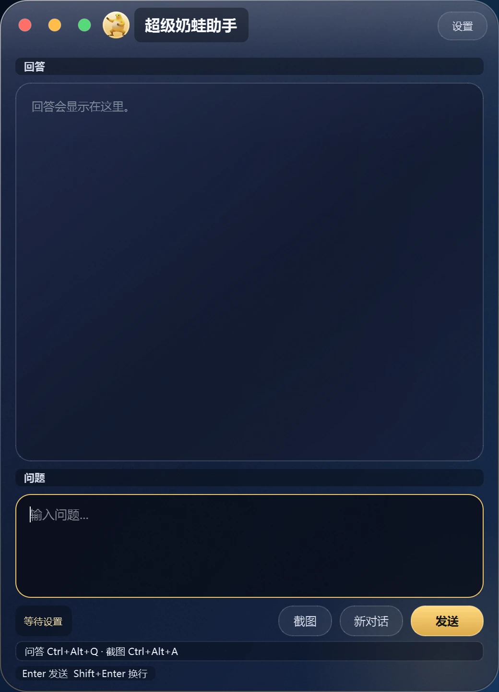
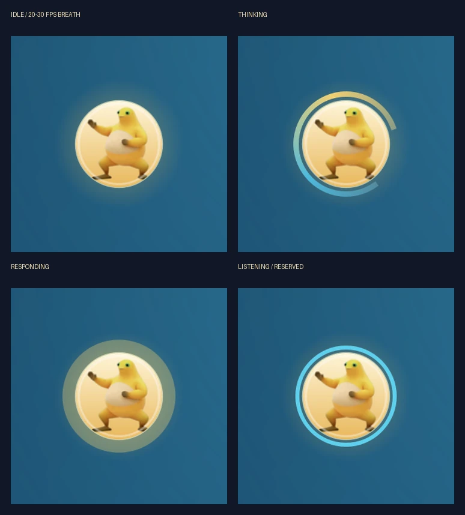
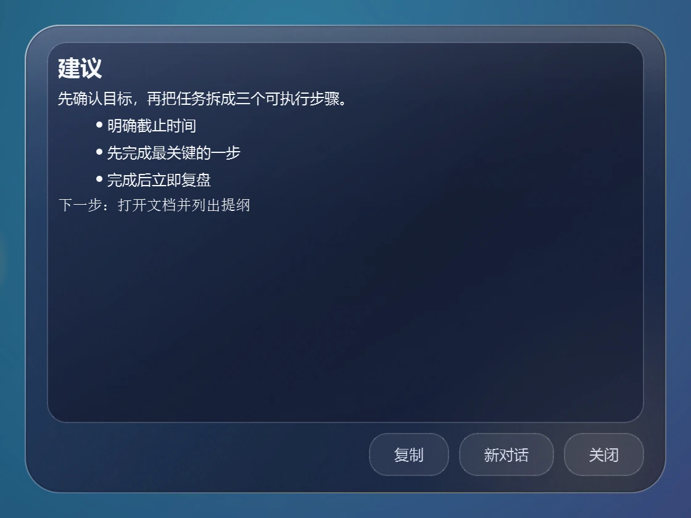
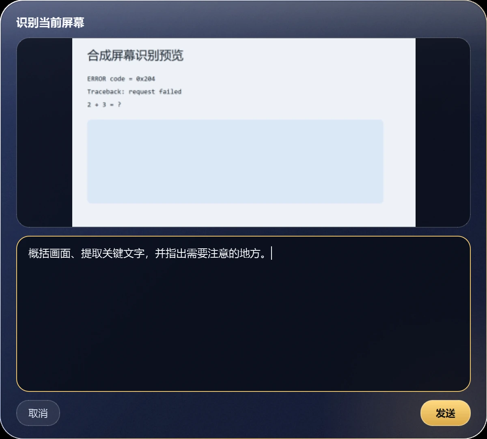
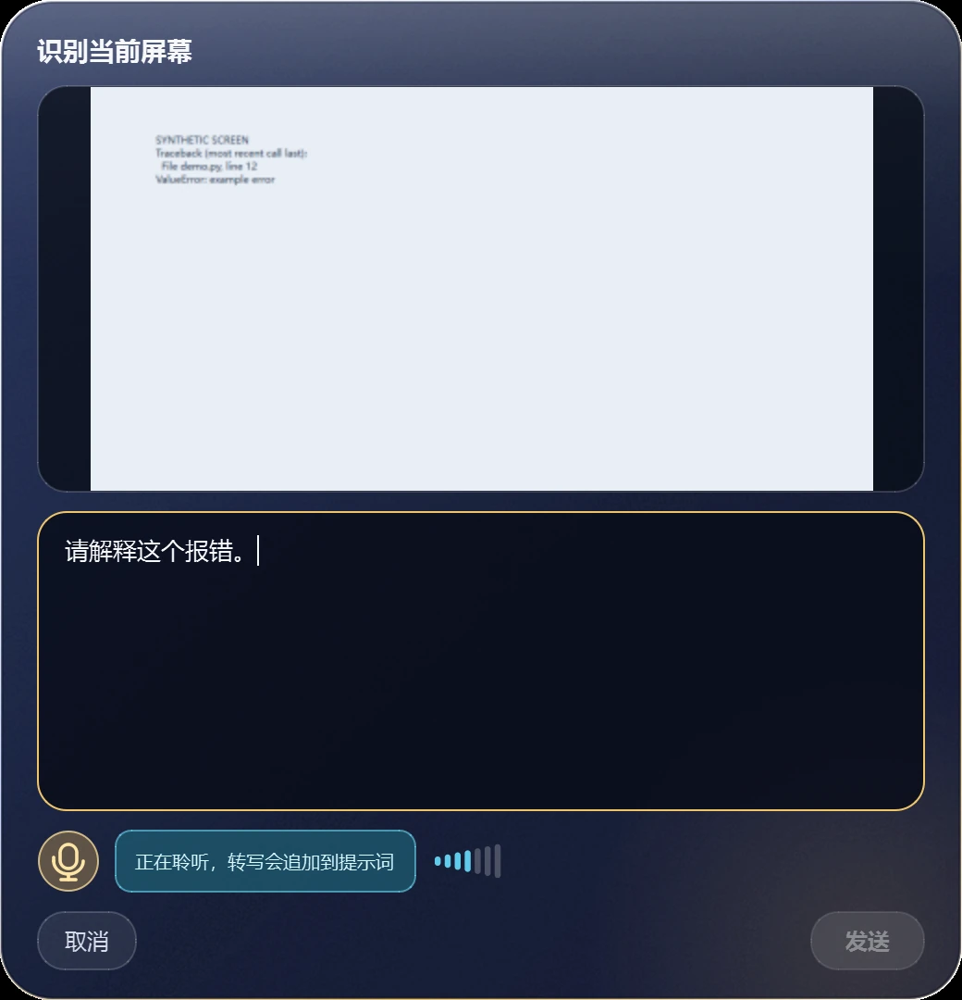
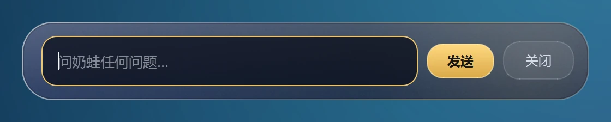
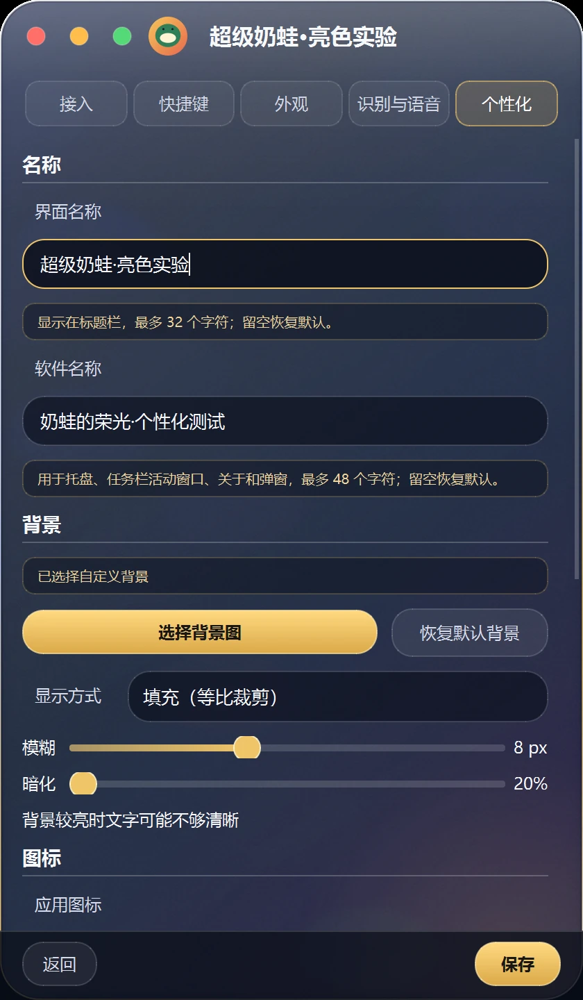

<p align="center">
  
</p>

<h1 align="center">奶蛙的荣光</h1>

<p align="center">
  Windows 10/11 x64 桌面 AI 搜题与全局助手。
</p>

<p align="center">
  <a href="https://github.com/54cbwkbvm8-cloud/vibe-coding/releases"><strong>下载最新版</strong></a>
  &nbsp;·&nbsp;
  <a href="#快速使用">快速使用</a>
  &nbsp;·&nbsp;
  <a href="#当前功能">当前功能</a>
  &nbsp;·&nbsp;
  <a href="docs/BROWSER_MODE.md">官网浏览器模式</a>
  &nbsp;·&nbsp;
  <a href="https://github.com/54cbwkbvm8-cloud/vibe-coding/issues">反馈问题</a>
</p>

<p align="center">
  
</p>

「奶蛙的荣光」是一款 Windows 桌面工具。它提供搜题模式和全局助手模式，
支持全局快捷键、区域截图、整屏识别、本地语音转文字、可调悬浮球、
个性化背景与名称，以及可选的非官方 DeepSeek 官网浏览器模式。

## 快速使用

1. 从 [Releases](https://github.com/54cbwkbvm8-cloud/vibe-coding/releases)
   下载 `奶蛙的荣光_v1.0.0_onedir.zip` 和对应的 `.sha256` 文件。
2. 解压后保持 `奶蛙的荣光.exe` 与 `_internal` 目录在同一层，不要只复制 exe。
3. 双击 `奶蛙的荣光.exe`。首次启动后打开设置，填写自己的 DeepSeek API Key。
4. 使用 `Ctrl+Alt+Q` 显示或隐藏主窗口，使用 `Ctrl+Alt+A` 框选屏幕截图。

在 PowerShell 中校验 ZIP：

```powershell
Get-FileHash .\奶蛙的荣光_v1.0.0_onedir.zip -Algorithm SHA256
Get-Content .\奶蛙的荣光_v1.0.0_onedir.zip.sha256
```

两处哈希必须完全一致。当前版本没有代码签名证书，Windows SmartScreen
可能显示“未知发布者”。请在确认下载来源和 SHA-256 后再决定是否运行。

## 当前功能

| 模块 | 功能 |
| --- | --- |
| 搜题模式 | 输入问题、区域截图提问、流式回答、多轮上下文、停止生成和新对话 |
| 全局助手 | 独立助手提示词和对话历史，使用 `Ctrl+Alt+Space` 唤出输入条 |
| 屏幕识别 | 使用 `Ctrl+Alt+S` 截取鼠标所在屏幕一次，支持预览、补充问题、取消和直接发送 |
| 本地语音 | SenseVoiceSmall 离线转写、静音检测、手动结束、转写后编辑 |
| 悬浮球 | 40–160 px 可调、拖动吸附、位置保存、显隐热键和托盘入口 |
| 个性化 | 自定义背景、界面名称、软件显示名称、三个图标位置和桌面快捷方式 |
| 快捷键 | 录制式改键、冲突校验、恢复默认和事务注册 |
| 官网浏览器 | 独立内嵌浏览器壳显示 DeepSeek 官网页面；不读取页面，不自动收发 |

## 界面预览

| 全局助手 | 回答气泡 |
| --- | --- |
|  |  |

| 屏幕识别 | 本地语音 |
| --- | --- |
|  |  |

<p align="center">
  
</p>

<p align="center">
  
</p>

## 快捷键

| 功能 | 默认快捷键 | 生效范围 |
| --- | --- | --- |
| 显示/隐藏主窗口 | `Ctrl+Alt+Q` | 搜题模式 |
| 区域截图 | `Ctrl+Alt+A` | 搜题模式 |
| 助手唤出 | `Ctrl+Alt+Space` | 全局助手模式 |
| 悬浮球显隐 | `Ctrl+Alt+B` | 全局助手模式 |
| 整屏识别 | `Ctrl+Alt+S` | API 接入下的两种工作模式 |

所有快捷键都可以在设置页中录制修改。组合键必须至少包含 Ctrl、Alt、Shift
或 Win 中的一项；保存时如果新组合被其他程序占用，程序会回滚并保留旧组合。

## 配置

普通配置保存在：

```text
%APPDATA%\AIQuizOverlay\config.json
```

API Key 使用 Windows DPAPI 加密后单独保存到：

```text
%APPDATA%\AIQuizOverlay\api_key.bin
```

语音模型和官网浏览器组件不随主程序打包。模型默认安装到
`%APPDATA%\AIQuizOverlay\models\`，官网浏览器组件安装到
`%APPDATA%\AIQuizOverlay\components\`。完整配置项见
[docs/CONFIGURATION.md](docs/CONFIGURATION.md)。

## 从源码运行

建议使用 Windows 10/11 x64 和 Python 3.11 x64：

```powershell
py -3.11 -m venv .venv
.\.venv\Scripts\Activate.ps1
python -m pip install --upgrade pip
python -m pip install --only-binary=:all: -r requirements.lock
python main.py
```

不要从其他系统复制虚拟环境，也不要把虚拟环境放在 Parallels 共享文件夹中。

## 打包

```powershell
python -m pip install -r requirements-build.txt
powershell -ExecutionPolicy Bypass -File .\build\build.ps1
powershell -ExecutionPolicy Bypass -File .\build\package.ps1
```

发布包采用 PyInstaller `onedir` x64 形式。构建、检查、可选组件和故障排查
见 [docs/BUILDING.md](docs/BUILDING.md)。

## 官网浏览器模式

「DeepSeek 官网（浏览器模式）」是可选、实验性、非官方接入方式。它需要
单独构建并手动导入 QtWebEngine 组件，组件 ZIP 不随主程序或 GitHub Release
提供。

该模式只做浏览器显示和普通导航：不读取页面内容或 Cookie，不自动填入、
不自动点击、不自动发送。截图和语音转写结果只复制到系统剪贴板，由用户
自己在官网页面按 `Ctrl+V`。

该模式使用 DeepSeek 网站和账号服务，消息会进入对应官网账号历史。它不是
DeepSeek 官方客户端，可能受官网改版、验证码、限频或账号限制影响。使用前
请阅读 [官网浏览器模式说明](docs/BROWSER_MODE.md) 和
[DISCLAIMER.md](DISCLAIMER.md)。

## 已知限制

- 当前正式构建为 Windows x64；Windows ARM64 通过 x64 模拟运行，不是原生版本。
- 真实双屏、混合缩放、屏幕旋转和副屏定位仍需在物理环境验证。
- 受 DRM、独占全屏或其他保护机制影响时，屏幕截图可能为黑屏。
- HEIC、AVIF 等 Qt 不支持的格式需要先转换为 PNG 或 JPG。
- 本地语音的准确率、延迟和噪声表现与麦克风、驱动及硬件有关。
- 官网浏览器只允许 `deepseek.com` 主框架在壳内导航，其余链接交给系统浏览器。
- 官网浏览器组件不会自动更新；需要定期使用新的 PySide6-WebEngine 重新构建。

## 隐私与安全

- 屏幕识别只在按下快捷键后截取一次，不进行后台持续截屏。
- 截图、录音和转写文字在内存中处理，不写入日志。
- 日志只记录事件和状态码，不记录 Key、问题、回答、图片、音频、Cookie 或 Token。
- API 接入的生产请求固定发送到 `https://api.deepseek.com`。
- 模型下载只在用户点击“开始下载”后访问固定白名单来源，并校验固定 SHA-256。

更多说明见 [docs/PRIVACY.md](docs/PRIVACY.md)。

## 免责声明

本软件按现状提供，不提供任何明示或暗示的担保。软件作者和贡献者不对因
使用本软件产生的数据丢失、账号限制、经济损失或其他损失负责。官网浏览器
模式不是官方客户端，与 DeepSeek 及其关联公司不存在隶属、代理、合作或
背书关系。完整文本见 [DISCLAIMER.md](DISCLAIMER.md)。

本声明为通用文本，不是法律意见，不能改变 DeepSeek 官网协议的约束。

## 第三方声明与致谢

项目使用 PySide6、Qt、sherpa-onnx、onnxruntime、sounddevice、PortAudio、
WebRTC VAD 等开源组件。版本、许可证和来源见
[THIRD_PARTY_NOTICES.md](THIRD_PARTY_NOTICES.md)。各组件和商标归其各自
所有者。

## 许可证

代码许可证以仓库根目录的 [LICENSE](LICENSE) 为准。`assets/brand/` 中的
品牌图片不在 MIT 授权范围内，保留所有权利，详见
[assets/brand/COPYRIGHT.md](assets/brand/COPYRIGHT.md)。第三方组件、模型
和 DeepSeek 网站内容不因代码许可证而重新授权。
